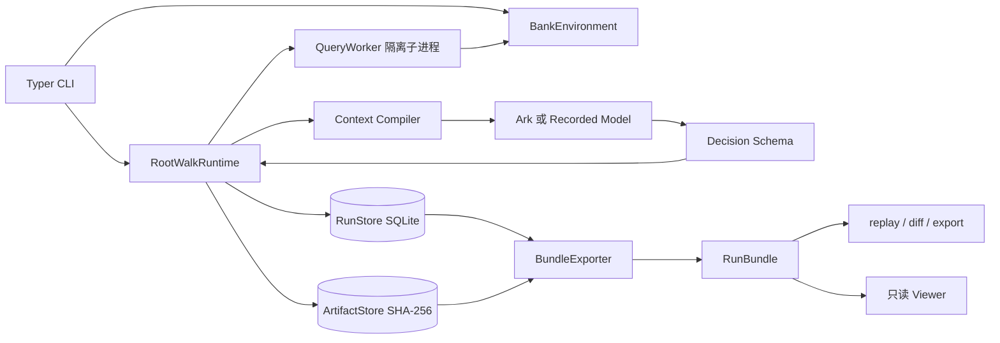
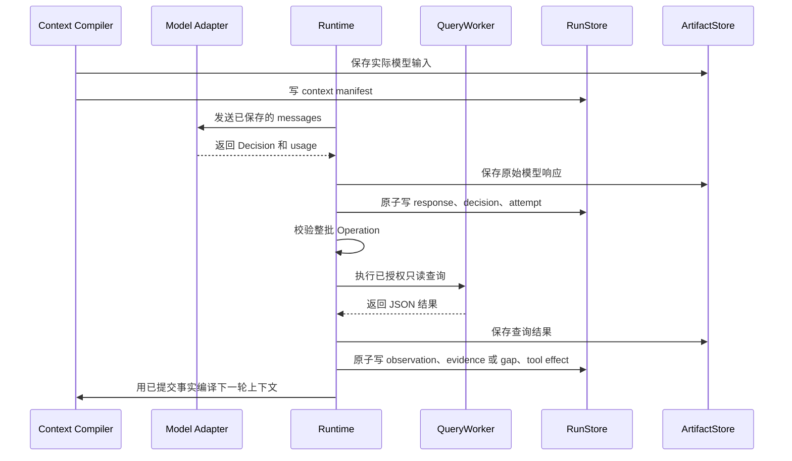
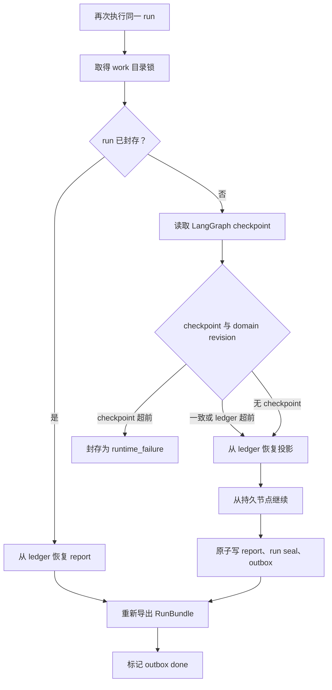

# RootWalk 架构

RootWalk 当前是一套本地、单任务的 RCA Agent Harness。它把模型决策、只读查询、证据和候选因果路径写进可校验的 RunBundle，重点是让调查过程可追溯。RunBundle 正常封存只说明流程走完，不代表根因正确。

## 组件和数据流

CLI 负责装配当前唯一的 Bank 数据环境、模型适配器、工作目录和单写者锁。模型只返回严格校验的 `Decision`，不能直接执行工具。Runtime 校验整批 Operation，再把查询交给可终止的子进程；Linux 默认由 bubblewrap 只读暴露 runtime、包代码和当前 `public_input`，同时隔离网络。requested/effective sandbox 模式、bwrap 版本和 executable SHA-256 会从实际 QueryExecutor 读取并冻结到 manifest 与 report，供恢复和 benchmark 复用校验。状态变更、模型响应和查询效果按稳定键写入 SQLite。`BundleExporter` 只导出已提交的记录与内嵌 Artifact，原始大文件保留为 external 引用。

## 调查事实分层

| 层 | 当前载体 | 能说明什么 | 不能直接说明什么 |
| --- | --- | --- | --- |
| 来源数据 | `public_input`、manifest、external Artifact | 某份冻结输入里有什么，以及文件大小和 SHA-256 是否匹配 | 数据采集一定完整、线上现状仍相同 |
| Observation | 工具参数、状态、Coverage、Artifact 引用 | 某次只读查询实际返回了什么 | 返回值已经构成根因证据 |
| Evidence 或 gap | 主体、谓词、值、时间范围、不确定性、来源指纹 | Runtime 从 Observation 提取出的可引用事实，或无法安全提取的缺口 | Evidence 之间已经存在因果关系 |
| Hypothesis | 支持、反证、开放问题、状态 | 模型提出并持续修订的候选判断 | `supported` 等同于真实根因 |
| Path | 候选步骤、拓扑依据、证据引用、Grounding 结果 | 候选因果链能否通过引用、结构、时间和覆盖检查 | 观察关联已经证明因果 |
| Report | 选中的 Hypothesis、Path、gap、预算和终止状态 | 封存时 Runtime 接受了什么，或为何拒答 | 调查准确率或生产效果 |

`TopologySnapshot` 里的边是输入数据支持的事实关系。模型提交的 `Path` 是候选因果链，两者不能混为一层。`observe_only` 会把质量问题留在审计记录里，不把反馈送回模型；`enforce` 会把校验错误反馈给下一轮，并阻止不合格结果通过 Exit Gate。

## 一轮调查怎样落盘

图中的顺序是恢复语义的基础。模型响应和 Decision 先于工具效果提交；一次查询的 Observation、Evidence 或 gap、effect 和 attempt 又在同一事务里提交。稳定键让重放同一个已提交效果时返回原 revision，内容冲突则失败，不会静默覆盖。

## 恢复和封存

CLI 把持久状态放在输出目录旁的 `.<output-name>.work/`，其中包括 `run.sqlite3`、内容寻址 Artifact 和 `run.lock`。恢复时必须使用相同的 `--output` 与 `--run-id`。

每个 Run 新写入的内容寻址 Artifact 默认最多 64 MiB。恢复时从 Artifact 目录继承已用字节；相同内容的 blob 只计一次，`public_input` 中只登记为 external 的原始切片不计入这个额度。超限时不会落临时文件或孤儿文件，Runtime 以 `budget_exhausted` 封存，并在报告中保留 `artifact_budget` gap。

LangGraph 使用同步持久化。若进程在领域记录提交后、Checkpoint 更新前退出，恢复会以 ledger 为准，已提交的 Decision 和工具效果不会再次调用外部模型或查询。若 Checkpoint revision 反而领先，Runtime 会失败关闭并封存 `runtime_failure`。首次启动写下的绝对 `deadline_at` 也会沿用，重启不能重置总时限。

Run seal 之后，普通领域记录不能再追加，只允许 `late_audit`。封存和 pending outbox 在一个事务里提交；RunBundle 导出成功后才把 outbox 标成 done。导出先写同父目录 staging，完整成功后再原子替换目标；失败时不留下半成品，SQLite 与 pending outbox 保持可恢复状态。

## RunBundle 边界

当前 Bundle 包含 `manifest.json`、`task.json`、`topology.json`、`report.json`，以及 Decision、Attempt、Observation、Evidence、调查事件、Context manifest、预算流水等 JSONL 文件。`artifact_index.json` 标出 Artifact 是 embedded、external 还是 redacted。默认导出不复制大体积 external Artifact。

`rootwalk export --self-contained --external-root ...` 可以显式生成自包含副本。导出器只接受 external-root manifest 中已登记、大小和 SHA-256 均匹配的文件，并拒绝 symlink、路径逃逸、内容漂移和 `evaluation_only` Artifact。新 manifest 记录所有非 manifest 文件的哈希、完整性状态和 Bundle 总字节数。

Viewer 是浏览器内的只读调试工具。它解析用户选择的 JSON 和 JSONL 文件，但当前不会复算 manifest 哈希，所以安全边界仍以 CLI 校验为准。
