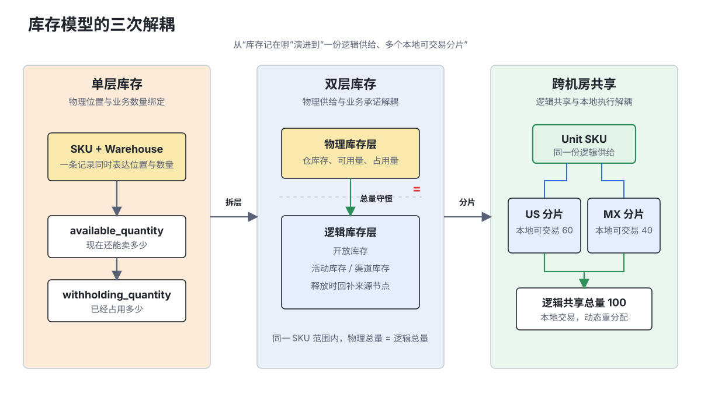
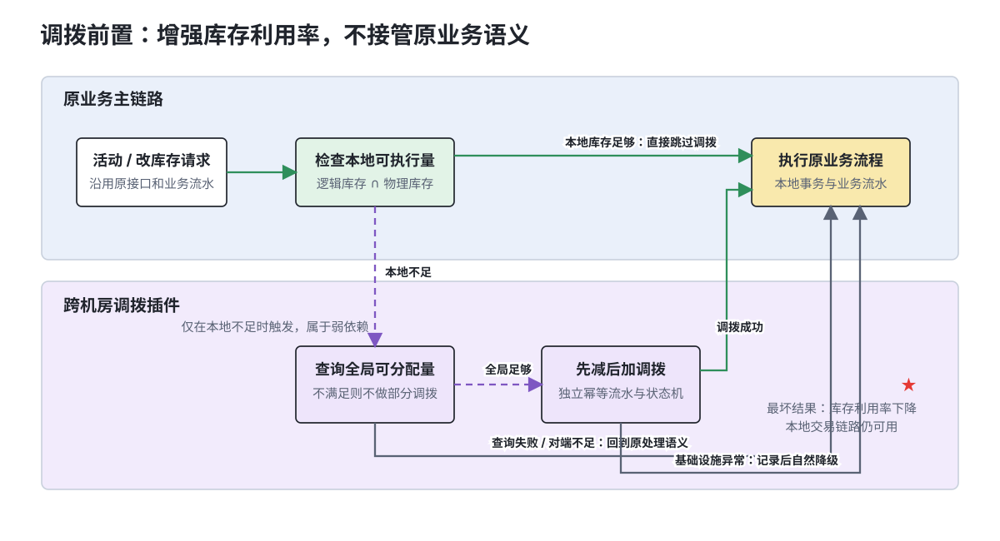
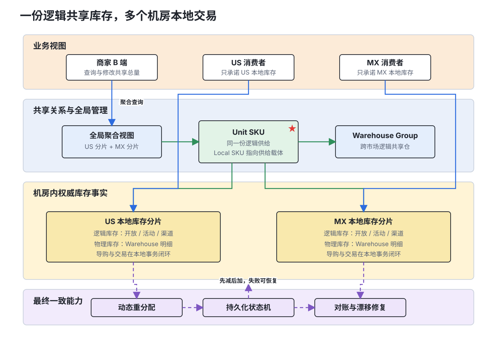
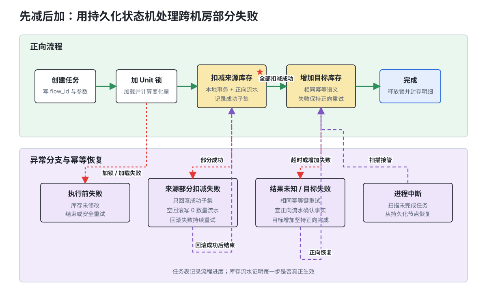

# 共享的不是一条库存记录：从双层库存到跨机房共享

> 一份库存如何同时服务多个市场，又不让消费者为跨机房网络承担延迟和故障风险？本文以一个真实的跨市场库存项目为背景，介绍库存模型如何从单层演进到双层，再从同机房共享演进为跨机房的分布式库存池，并重点讨论动态重分配、跨机房事务、幂等、降级与对账。

## 摘要

在跨市场经营场景中，同一份实物供给需要同时服务多个国家和店铺。如果每个市场独立维护库存，就会形成库存割裂；如果所有市场实时操作同一条中心库存，又会把跨机房时延和故障带入消费者交易链路。

最终方案没有选择“所有市场共享一条远端库存记录”，而是将共享库存建模为：**一份逻辑共享库存，多个机房本地可交易分片**。商家侧汇总表达总库存，消费者侧在本机房完成导购和正常交易；系统通过 Unit 级并发控制、动态重分配、先减后加的跨机房状态机、幂等流水、降级和离线对账，维持全局库存语义。

本文隐去了公司内部服务名、业务量级和具体配置，重点保留逻辑/物理双层一致性、开放库存调拨、动态重分配，以及跨机房部分失败恢复等具有通用价值的模型、算法与架构取舍。

**关键词：** 库存模型、共享库存、跨机房、动态重分配、分布式事务、幂等、对账

## 一、问题不是“同步库存”，而是“同时满足三种正确”

跨市场共享库存表面上像一个数据同步问题：把市场 A 的库存同步给市场 B 即可。但库存不是普通配置数据。一笔订单一旦承诺成功，系统就必须保证后续能够完成占用、履约、取消和回补。

真正的矛盾来自三类目标：

1. **商家视角正确**：商家希望管理一份总库存，不需要提前决定每个市场分多少货；
2. **消费者视角正确**：消费者看到可售后，应尽量在本机房完成查询和下单；
3. **账目视角正确**：任意跨机房超时、重试或部分失败都不能让库存凭空增加或消失。

这三个目标无法通过“所有请求访问一条中心库存”同时满足。中心库存能提供最直观的总量语义，却会把跨机房网络变成 C 端交易的同步依赖；各机房完全独立又能获得低延迟和故障隔离，却会牺牲库存利用率。

因此，跨机房共享库存的核心不是复制一个库存数值，而是设计一套在**全局共享与本地交易之间可收敛、可降级、可验证**的库存模型。

## 二、模型演进：库存系统经历的三次解耦

库存模型不是一次设计完成的。随着业务从单仓销售演进到活动预占、多市场销售和跨机房交易，模型完成了三次关键解耦。



### 2.1 单层库存：货在哪里，库存就记在哪里

最简单的库存模型直接以 `SKU + Warehouse` 记录数量：

```text
SKU + Warehouse
  ├── available_quantity
  └── withholding_quantity
```

它同时回答两个问题：

- 这批货在哪个仓；
- 现在还有多少可以卖。

例如某 SKU 在两个仓分别有 60 和 40 件，总库存就是 100。对于没有活动、渠道和复杂预留的业务，这个模型直接且高效。

### 2.2 单层模型的边界：物理位置与业务承诺被绑在一起

当系统需要支持活动库存、渠道库存、达人库存等业务形态时，“货在哪里”和“这份货承诺给谁”开始成为两个不同问题。

假设总库存 100 件，其中开放销售 60 件、活动 A 20 件、活动 B 10 件、特定渠道 10 件。如果所有业务份额都直接拆到仓维度，库存记录会沿着“仓 × 业务用途”快速膨胀；活动调整、释放和回补也需要同时修改多份物理仓数据。

更棘手的是，活动通常关心总共能承诺多少，而履约才关心最终从哪个仓出货。过早把活动份额绑定到具体仓，会让业务策略与物理供应关系互相污染。

### 2.3 双层库存：物理供给与业务承诺解耦

双层库存将库存拆成两个相互约束的层次：

| 层次 | 回答的问题 | 典型数据 |
|---|---|---|
| 物理库存层 | 货在哪、每个仓实际能供应多少 | 仓库存、可用量、占用量 |
| 逻辑库存层 | 哪个业务还能承诺多少 | 开放库存、活动库存、渠道库存 |

逻辑库存可以形成树状结构：开放库存作为根节点，不同活动或渠道从上层库存派生。活动释放时，数量回补到它的来源节点，而不是简单删除一条记录。

双层模型最重要的不变量是：

```text
在同一 SKU 和同一统计范围内：
物理库存总量 = 逻辑库存总量
```

若区分可用与占用状态，两个层次的变化也必须能够相互解释。逻辑层显示可售，但物理仓无法供应，会导致导购有货、下单或履约失败；物理仓有货但逻辑层没有额度，则会造成少卖。

双层模型解决了“一份库存如何承载多个业务用途”，却还没有解决“多个市场如何消费同一份供给”。这推动了第二次解耦。

### 2.4 Local 与 Unit：销售视图与供给载体解耦

同一商品进入不同市场后，通常会形成不同的 Local SKU。Local SKU 表达市场、店铺和销售属性，但它并不一定应该独立拥有一份库存。

因此，共享库存引入了 Unit SKU：

```text
Global SKU：识别不同市场中的同一商品
Local SKU：面向市场和店铺的销售视图
Unit SKU：真正承载库存的供给单元
```

同机房内的多个 Local SKU 可以指向同一个 Unit SKU。例如 GB、FR、DE 位于同一机房时：

```text
GB Local SKU ─┐
FR Local SKU ─┼── Unit SKU ── 库存 100
DE Local SKU ─┘
```

这意味着 Local SKU 决定“在哪里卖”，Unit SKU 决定“卖的是哪份库存”。同机房场景下，多个 Local SKU 可以直接访问同一条 Unit 库存行，数据库事务边界与共享边界一致，问题相对简单。

### 2.5 跨机房共享：逻辑共享与本地执行解耦

当两个市场位于不同机房时，共享一条库存行意味着至少一个市场必须访问远端。此时系统需要完成第三次解耦：共享的是逻辑库存语义，而不是数据库记录。

同一个 Unit SKU 在不同机房拥有本地库存分片：

```text
                    Unit SKU
                   /        \
          US 本地分片      MX 本地分片
              60               40
                   \        /
               逻辑共享总量 100
```

同一个 Unit SKU 表达“这是同一份供给”；各机房库存分片表达“这份供给当前有多少能在本机房立即交易”。Warehouse Group 则描述不同市场中的业务仓如何映射为同一个逻辑共享仓。

## 三、为什么不选择更简单的方案

在确定最终架构前，方案设计阶段重点比较了三种路径。

### 3.1 方案一：所有市场实时访问中心库存

中心库存只有一份账，模型最直接，也不需要库存重分配。但它的问题同样明显：

- C 端查询和下单依赖跨机房网络；
- 跨机房抖动会直接降低交易成功率；
- 热点 SKU 会同时形成网络热点和单行写热点；
- 中心机房故障可能扩大为全局故障。

这套方案把一致性问题简化了，却把可用性问题推给了消费者链路。

### 3.2 方案二：各机房完全独立管理库存

各机房独立后，查询、下单和故障都能本地闭环。但商家必须提前分配库存，一个市场售罄时，另一个市场可能仍有大量闲置库存，整体售卖机会下降。

更重要的是，它没有提供真正的共享语义，只是把一份供给静态切成了多份。

### 3.3 最终方案：本地分片与动态调度

最终架构保留每个机房的本地交易能力，同时在上层维持逻辑共享：

```text
一份逻辑共享库存
  + 多个机房本地可交易分片
  + 动态重分配
  + B 端全局聚合视图
```

这不是最简单的方案，但它把跨机房故障的影响限制在库存利用率和全局管理体验上，而不是直接拖垮本地交易。

### 3.4 为什么选择“调拨前置”，而不是重写原有库存流程

确定使用本地分片后，还需要回答一个工程问题：当本机房库存不足、全局库存充足时，是重写活动库存和商家库存的原有扣减流程，让它们直接跨机房扣库存，还是先把库存调到本机房，再复用原流程？

最终选择了“调拨前置”：调拨是原有库存流程前的一个弱依赖插件，负责在必要时补足本机房库存；完成后，活动创建、库存修改等业务仍然执行原来的本地流程。



这个方案有四个直接收益：

| 设计收益 | 说明 |
|---|---|
| 工程量较小 | 复用原有库存扣减、活动创建和幂等流水，只新增本地库存不足时的调拨步骤 |
| 可插拔 | 非跨机房共享 SKU、本地库存充足或功能关闭时，调拨步骤直接跳过 |
| 可用性高 | 跨机房查询或调拨失败不会把原有本地库存流程一起拖垮，系统自然退化为原来的处理语义 |
| 流水语义稳定 | 调拨流水只记录库存位置变化，原业务流水继续记录真实的业务变更量，两类数据不会混在一起 |

以 US 本地开放库存 40、MX 开放库存 20，US 需要创建 50 件活动库存为例：

```text
调拨流水：MX -10，US +10
业务流水：US 开放库存 -50，US 活动库存 +50
```

如果把远端库存补给直接揉进活动创建请求，活动流水就可能混入“为跨机房补量而产生的 +10”，后续审计、幂等和对账都无法再只根据流水还原业务语义。将调拨拆成独立步骤后，调拨只改变库存位置，不改变全局总量；活动流水仍然准确表达“创建 50 件活动库存”。

调拨也是弱依赖：

- 本机房库存足够时，完全不触发调拨；
- 对端没有足够可分配库存时，不做部分调拨，继续执行原流程；
- 跨机房基础设施异常时，记录异常并让原流程按原有规则继续；
- 调拨成功但后续业务操作失败时，全局总量并未改变，只是库存分布暂时偏离目标，后续重分配可以重新收敛。

因此，跨机房能力是一层可拔插的“库存利用率增强”，而不是原有交易流程的硬依赖。最坏情况下系统回到改造前的本地库存语义，而不是进入一半新流程、一半旧流程的不可解释状态。

## 四、总体架构：全局管理，本地交易



### 4.1 B 端表达全局总量

商家关心的是“这份商品一共还有多少库存”。因此，B 端查询会根据 Local SKU 找到对应 Unit SKU 和 Warehouse Group，再查询关联机房的库存分片并汇总：

```text
共享总库存 = US 分片 + MX 分片
```

商家在任意店铺修改库存时，操作的也是总库存。系统负责把变化量转换成各机房的具体增减。

### 4.2 C 端只承诺本机房库存

消费者关心的是“现在能不能买、什么时候能收到”。正常导购、售罄计算和下单优先只使用本机房库存：

```text
C 端可售库存 = 本机房可立即扣减的库存
```

这使得 C 端不需要为每次查询承担跨机房往返时延，也避免远端故障直接影响本地交易。

这里存在一个刻意接受的差异：B 端看到的总库存可能大于某个市场 C 端当下的可售库存。系统通过调拨和重分配逐步收敛，而不是要求每个请求都实时跨机房强一致。

### 4.3 Warehouse Group 收敛仓关系

仅靠 Entity Warehouse 很难表达跨市场共享关系：同一个物理仓在不同商家或市场视角下可能有不同业务仓标识；反过来，逻辑上应该共享的仓也可能分布在不同机房。

Warehouse Group 将仓关系收敛到库存域：属于同一 Warehouse Group 的仓，在库存调度时被视为同一逻辑共享仓。这样，上游不需要理解各机房的库存行和调拨细节，只需要传递稳定的业务仓关系。

## 五、共享关系创建：不是一次简单的写入

创建共享关系并非把多个 Local SKU 填进一张关系表。为了避免错误合并和库存丢失，系统需要完成多阶段校验与写入：

```text
校验输入 SKU
  → 加载 Global/Local 关系
  → 跨机房加载已有库存
  → 查询仓及 Warehouse Group
  → 计算重置库存
  → 生成或复用 Unit SKU
  → 按机房聚合并写入
  → 触发重分配
```

其中，业务校验包括：输入 Local SKU 是否属于同一个 Global SKU、分片关系是否兼容、商品模型是否允许共享、仓关系是否完整，以及设置目标库存后开放库存是否仍然非负。

这些校验应当同步完成。因为参数错误、商品关系错误等确定性失败需要即时返回给调用方；真正重的部分是按机房展开并写入 `Local SKU × Warehouse` 明细。若后续需要异步化，更合理的边界是在完成业务校验之后，把跨机房写入与重分配交给异步任务，而不是把整个入口都放到消息队列后面。

还需要区分两个响应语义：

- **创建完成**：所有目标机房已经建立共享关系；
- **任务已接受**：系统只确认异步任务进入处理队列。

如果二者复用同一个 `Success`，上游会把“已接受”误解为“已经可以查询到共享关系”。因此，异步接口应显式表达任务状态和区域级执行明细。

## 六、动态重分配：共享能力的核心调度器

共享关系只定义了“哪些库存可以共享”，重分配才决定“每个市场此刻可以卖多少”。

### 6.1 可分配库存口径

某机房能够调出的库存不能只看开放库存，也不能只看物理仓库存，而是：

```text
机房可分配库存
  = min（机房开放库存，机房共享仓物理库存之和）
```

这是双层库存约束的直接结果。开放库存表示逻辑上还能承诺多少，物理仓库存表示实际能供应多少，任何一侧不足都不能继续向外分配。

### 6.2 深库存按权重，浅库存按优先级

库存充足时，可以按照市场权重计算目标值：

```text
市场目标库存
  = 总可分配库存 × 市场权重 / 总权重
```

无法整除的余数，根据商品可售状态和市场优先级分配。权重表达长期经营策略，优先级解决离散余数和极浅库存下的选择。

当总库存低于安全阈值，或者总库存甚至小于市场数量时，继续机械地按权重计算可能让某些市场长期保持 0。此时策略需要退化：优先保证商品仍可售的市场，并尽量让有限库存产生实际销售机会。

### 6.3 一个简化案例

假设当前可参与共享的库存为：

| 市场 | 开放库存 | 共享仓库存 | 可分配库存 |
|---|---:|---:|---:|
| US | 48 | 16 | 16 |
| MX | 4 | 11 | 4 |

全局可分配总量为 20。若目标权重为 1:1，则两个市场的目标值均为 10：

```text
US：16 → 10，变化量 -6
MX： 4 → 10，变化量 +6
```

系统还需要把开放库存的变化投影到具体 Warehouse Group 和 Unit 库存行。这个过程不能破坏任何一个机房内部的双层一致性，也要尽量让每个有效共享仓都保留库存，避免逻辑层有量但实际无法寻仓。

### 6.4 重分配触发

重分配通常由三类事件触发：

1. 库存低于浅库存阈值；
2. 商家修改库存、活动释放等业务动作；
3. 离线任务定期扫描和修复长期漂移。

在线触发负责快速恢复销售能力，离线触发负责最终收敛和兜底。两者缺一不可。

## 七、活动库存为什么比普通库存更难

活动库存是逻辑库存树中的子节点。商家在某个市场报名活动时，业务上希望使用全局共享的开放库存，但活动的创建和后续交易仍然需要在本机房完成。

假设共享开放库存总量为 60，其中 US 40、MX 20。US 需要创建 50 件活动库存：全局看库存足够，但 US 本机房只有 40。如果直接创建活动，本机房的物理仓和开放库存无法供应这 50 件，后续交易会失败。

正确流程是在原业务前插入调拨插件：

```text
校验全局开放库存
  → 发现本机房不足
  → 从对端调拨开放库存与物理仓库存
  → 本机房达到目标
  → 创建活动库存
```

活动释放相对简单：它把数量回补到本机房开放库存，不需要先从远端获取库存。但释放后本地可能形成大量富余，因此还需要异步触发重分配，让共享库存重新接近目标权重。

这部分设计体现了一个重要原则：**全局可用并不代表本地可执行**。任何逻辑库存操作都必须先确认本机房的物理和逻辑库存能够共同支撑它。

## 八、跨机房一致性：把“不多不少”写成系统不变量

跨机房库存不能只依赖“请求成功”判断正确性。系统需要先定义可以持续验证的不变量。

### 8.1 全局守恒

对同一批调拨：

```text
所有机房增加量之和 + 所有机房减少量之和 = 0
```

调拨只能改变库存位置，不能改变全局总量。

### 8.2 机房内双层一致

每个机房内部，逻辑开放库存和活动库存都必须能被物理仓库存充分供应。全局守恒并不能替代机房内一致：即使 US 减少 6、MX 增加 6，若只调整开放库存而没有调整物理仓库存，MX 依然可能无法下单。

### 8.3 Unit 级并发控制

重分配的原子是 Unit SKU。对同一个 Unit 同时执行两次调拨，会让两个任务基于相同旧值计算并相互覆盖。因此系统以 Unit SKU 为粒度获取分布式锁，将同一份共享供给的调度串行化。

锁粒度不能过大，否则无关商品相互阻塞；也不能落在 Local SKU 上，因为同一个 Unit 下的多个 Local SKU 本质上操作的是同一份共享供给。

### 8.4 为什么使用本地消息表式状态机



跨机房调拨不是一个可以被数据库本地事务覆盖的原子操作。如果采用 XA 或长时间持有两端资源锁的两阶段提交，跨机房延迟、网络分区和协调器故障都会直接拉低可用性；如果只同步调用两个机房，又无法在进程宕机后知道事务停在了哪一步。

几种常见方案的差异如下：

| 方案 | 能解决什么 | 在该场景中的问题 |
|---|---|---|
| XA / 两阶段提交 | 在协议层提供强一致提交 | 跨机房长尾延迟会放大锁持有时间，协调器或网络故障还会扩大阻塞面 |
| TCC | 通过 Try / Confirm / Cancel 显式控制事务 | 参与方改造面大，需要为库存资源额外设计预留态，接入成本与原流程侵入性较高 |
| 纯 MQ / Outbox | 保证事件最终送达并支持消费重试 | 只能回答“消息是否投递”，不能独立回答事务应继续增加还是转入回滚，也不能天然表达部分成功子集 |
| 本地消息表式持久化状态机 | 持久化当前节点、参数、重试时间和执行明细 | 需要额外任务表、扫描器、幂等流水和积压治理，但可用性与改造成本更匹配库存场景 |

库存调拨的核心难题不只是“把一条消息送到另一个机房”，而是服务重启后仍能回答三个问题：**已经执行到哪一步、这一步实际上有没有生效、下一步应该正向完成还是反向回滚**。因此，任务记录必须成为可恢复的流程事实，而不能只依赖一次 RPC 返回值或 MQ 消费状态。

这类库存操作更适合最终一致：每个机房内的库存变更是本地原子操作，跨机房流程由一个类似本地消息表的持久化状态机串联。任务开始前先写入一条事务记录，记录：

```text
flow_id
当前节点与节点状态
下次重试时间
序列化业务参数
节点执行明细
版本号
```

状态机每完成一个关键节点，就更新任务记录。节点本地重试仍失败时，任务保留在失败节点；后台扫描未完成或长时间无心跳的任务，重新加载参数并从当前节点继续执行。

选择这种实现主要基于以下考虑：

1. **接入轻量**：状态机编排位于本地业务代码，不要求所有参与方实现完整的 Try/Confirm/Cancel；
2. **不长期锁资源**：每一步都是短本地事务，适合高吞吐库存场景；
3. **进程故障可恢复**：服务宕机不会丢失事务进度，扫描任务可以接管；
4. **支持正向与反向编排**：比传统“只会不断重发消息”的本地消息表更适合库存扣减、增加与回滚；
5. **同步链路可控**：首次执行可以同步推进，失败后再转为持久化重试，不需要让所有正常请求都等待远程恢复。

它也有代价：任务表会带来额外 DB 写入和扫描压力，远程重试时部分上下文需要重新加载，状态机平台本身也会提高排障成本。因此，任务参数必须尽量自包含，重试流量要有独立标识，任务积压、节点重试次数和最终失败都需要监控。

### 8.5 分布式事务异常处理：不是所有失败都回滚

执行顺序采用先减后加，但异常不能简单处理成“任何失败都回滚”。恢复动作必须先区分四类信号：**执行前失败、结果明确的业务失败、结果未知的超时，以及执行进程中断**。不同阶段代表不同的事实状态：

| 异常位置 | 数据状态 | 处理策略 |
|---|---|---|
| 加锁、加载或计算失败 | 尚未修改库存 | 释放资源并结束，可由原业务流程 fallback 或安全重试 |
| 来源扣减明确失败 | 可能只有部分账户扣减成功 | 回滚已经成功的扣减，未成功部分不处理 |
| 来源扣减超时未知 | 不能确认远端是否落库 | 使用相同幂等键重试，并根据正向流水判断真实执行结果 |
| 来源全部扣减成功，目标增加失败 | 全局总量暂时减少 | 保持在“目标增加”节点正向重试，直到增加成功，不立即反向回滚 |
| 回滚失败 | 部分扣减尚未恢复 | 保持在“回滚”节点持续重试并告警，直至恢复完成 |
| 执行进程宕机 | 任务停在最后持久化节点 | 扫描任务接管，从当前节点恢复 |

目标增加失败后选择正向重试，而不是立刻回滚来源，有两个原因：

- 来源已经完整扣减，事务方向已经确定；目标增加是一个具备幂等性的可重试操作，正向完成路径更短；
- 如果此时反向回滚，而其他库存操作已经基于扣减后的版本继续执行，回滚可能覆盖后续更新，产生更新丢失。

来源扣减阶段则不同：只有部分账户成功时，继续向目标增加会放大不一致，因此需要回滚成功子集。回滚本身同样可能遇到网络超时，必须作为一个独立、可持久化、可幂等重试的状态机节点，而不是在错误处理代码中“顺手调用一次”。

### 8.6 用库存流水解决超时未知、空回滚与悬挂

本地消息表负责记住“流程执行到哪”，库存操作流水负责证明“某一步到底有没有执行”。二者职责不同，缺一不可。

库存变更与正向流水在同一个机房的本地事务内提交，流水唯一键由业务来源、子操作、库存账户和事件类型等字段组成。分布式事务重试前先检查流水：

- 正向流水存在：说明该库存变更已经执行，本次重试按幂等成功处理；
- 正向流水不存在：才允许真正修改库存并写入流水。

回滚还需要额外处理 TCC/Saga 中常见的两个问题。

**空回滚：** 调用方超时后触发回滚，但正向请求可能根本没有到达。此时不能反向增加库存，否则会凭空造库存。系统不修改库存，只写一条数量为 0 的回滚流水，表示“该业务操作已经进入回滚态”。

**防悬挂：** 空回滚完成后，迟到的正向请求才到达。如果正向操作不检查回滚流水，就会在事务已经回滚后再次扣减库存。因此，正向执行前必须先检查对应回滚流水；一旦存在，拒绝这次迟到的正向变更。

完整判断可以归纳为：

| 当前请求 | 正向流水 | 回滚流水 | 动作 |
|---|---|---|---|
| 正向 | 不存在 | 不存在 | 修改库存并记录正向流水 |
| 正向重试 | 已存在 | 不存在 | 幂等成功，不重复修改 |
| 迟到的正向 | 任意 | 已存在 | 拒绝执行，防止事务悬挂 |
| 回滚 | 已存在 | 不存在 | 反向修改库存并记录回滚流水 |
| 空回滚 | 不存在 | 不存在 | 不改库存，记录 0 数量回滚流水 |
| 回滚重试 | 任意 | 已存在 | 幂等成功，不重复回滚 |

这套机制把“RPC 返回什么”与“库存实际上发生了什么”分离开。即使调用方只看到超时，也能通过持久化流水安全地重试、回滚和恢复。

### 8.7 为什么仍然坚持先减后加

先增加再减少会在中间阶段放大全局库存，产生超卖窗口；先减少再增加最多造成短暂少卖，并且可以依靠任务表、正向重试和补偿恢复。对于库存系统，宁可暂时少卖，也不能凭空多卖。

调拨流水使用独立事件记录来源减少和目标增加，与原业务流水隔离。这样既可以按同一 SourceID 校验全局守恒，也不会改变活动创建、商家改库存等原始流水的业务数值。

### 8.8 对账是模型的一部分

在线状态机只能保证单次执行尽量正确，无法证明系统永远不会漂移。系统至少需要两类对账：

- 流水守恒：同一批操作的增加量等于减少量；
- 关系一致：不同机房的 Warehouse Group 与 Local-Unit 关系一致。

低库存比深库存更容易产生超卖或少卖，因此可以对浅库存提高对账频率，对深库存采用周期性校验，控制对账成本。

## 九、故障降级：优先损失利用率，而不是交易可用性

跨机房网络发生故障时，继续强行维持全局实时视图只会扩大故障。更可控的降级方式是：

- 暂停新的跨机房调拨与重分配；
- C 端继续使用本机房已分配库存；
- B 端明确标识全局视图可能不完整；
- 故障恢复后重新聚合、对账并触发再平衡。

这种降级会暂时降低库存利用率：某市场售罄时，另一个市场可能仍有库存。但本地导购和交易仍然可用，故障不会沿跨机房依赖扩散。

设计分布式库存时，一个重要的优先级是：

```text
不超卖 > 本地交易可用 > 全局库存利用率 > 分配比例完美
```

## 十、规模化代价：共享能力天然伴随读写放大

跨机房共享不是免费的。

创建共享关系时，RPC 数量随关联机房数增长，明细写入量随 `Local SKU × Warehouse` 增长。大 SKU、多仓和多市场叠加后，即使入口请求数量不高，也可能在存储层形成显著写放大。

查询侧同样存在阶段性放大：

```text
读取 Local 库存
  → 解析 Warehouse Group
  → 解析 Unit SKU
  → 查询关联机房库存
  → 聚合返回
```

即使跨机房查询已经并发化，前置关系解析和二次查询仍会累积到端到端延迟。针对列表和展示类查询，可以考虑预计算共享库存视图、缓存 Local 到 Unit/Region 的映射，并允许区域级部分成功；交易和库存修改则继续使用严格语义。

写链路优化不能只调大批量。纯数量增减可以走批量 upsert 快路径，而携带过滤条件、状态或扩展字段修改的请求可能退化为逐行更新。批量越大，吞吐可能越高，但单事务持锁时间和热点冲突也会增加，需要在真实 SQL 路径上做观测。

## 十一、关键技术判断与实践总结

项目实践的重点并不是单纯新增接口，而是围绕以下几类问题建立完整闭环：

1. 梳理双层库存语义，明确全局开放库存、本机房开放库存、活动库存与物理仓库存的关系；
2. 在活动创建或增加前调拨开放库存，保证本机房具备真实供应能力；
3. 在活动释放后异步再平衡，避免库存长期堆积在释放发生的机房；
4. 让 Unit、Warehouse Group、幂等与跨机房状态机使用统一的业务语义；
5. 针对跨机房读写放大和部分失败，补充降级、对账与可观测性闭环。

项目中最重要的三个技术判断是：

- **全局管理与本地交易分离**：B 端可以聚合，C 端优先本地闭环；
- **调度原子选择 Unit SKU**：同一份共享供给的并发操作必须在同一边界内协调；
- **业务校验同步、重写入可异步**：确定性业务错误应即时返回，跨机房重写入可以通过任务化降低入口压力。

最终方案没有追求任意时刻所有机房库存完全相等，而是明确了全局守恒、机房内双层一致、本地交易可用和最终收敛四个层次的正确性。这种分层比笼统地宣称“跨机房强一致”更符合真实库存系统的成本与风险。

## 十二、反思与下一步

当前重分配主要根据固定权重、商品状态和浅库存阈值计算目标。它解决了库存分片的执行问题，但目标本身仍然相对静态。

未来可以把系统拆成两个循环：

- 慢循环根据需求预测、活动计划、补货周期和跨区履约成本计算各市场目标库存；
- 快循环根据实时库存变化，在目标附近执行重分配并处理突发浅库存。

这与 Amazon 的多层级库存优化思路类似：库存规划决定货应该提前放在哪里，交易库存只负责当前订单能否安全承诺。通过把“目标计算”和“调拨执行”解耦，可以减少交易时临时跨机房调拨，提高库存前置效率。

读侧也可以从实时跨机房聚合进一步演进为市场级预计算视图：库存事实源继续保证正确性，事件驱动的读模型为 B 端和展示场景提供低延迟查询，严格交易仍访问权威库存。

## 结语

跨机房共享库存的本质不是把一个库存数字同步到多个机房，而是将“共享”拆成多个层次：

- Global SKU 识别同一商品；
- Local SKU 表达不同市场的销售视图；
- Unit SKU 承载同一份供给；
- Warehouse Group 定义跨市场共享仓；
- 本地分片保证交易低延迟；
- 重分配、状态机、幂等和对账维持全局库存语义。

库存系统的每次演进，都是一次解耦：从物理供给与业务承诺解耦，到销售视图与供给载体解耦，最终再将逻辑共享与本地交易执行解耦。

共享的从来不是一条数据库记录，而是一组可以被持续验证的业务不变量。

## 延伸阅读

- [Shopify：Enterprise OMS Integration](https://shopify.dev/docs/apps/build/orders-fulfillment/order-management-apps/enterprise-oms-integration)
- [Adobe Commerce：Source Algorithms and Reservations](https://experienceleague.adobe.com/en/docs/commerce-admin/inventory/basics/selection-reservations)
- [Mercado Libre：User Products and Distributed Stock](https://global-selling.mercadolibre.com/devsite/manage-sales-global-selling/user-products-cbt)
- [Amazon Science：The Evolution of Amazon's Inventory Planning System](https://www.amazon.science/latest-news/the-evolution-of-amazons-inventory-planning-system)
- [Zalando：From Event-Driven Chaos to a Blazingly Fast Serving API](https://engineering.zalando.com/posts/2025/03/event-driven-to-api.html)
- [京东：库存领域核心能力——库存预占建设实践](https://developer.jdcloud.com/article/3742)
